# Plugging a real company's data into CategoryOS

How a mid-size Indian e-commerce company would connect its scattered category data to CategoryOS and run it as a pipeline. Every item below is labelled by what the repository does today:

- **exists**: runs in this repo now (on synthetic data).
- **adapter needed**: the core logic exists, but a thin piece of new code is needed to reach the real source.
- **roadmap**: not built. No code in the repo.

No connector to any external business system (email, ERP, PIM, marketplace, WMS) exists today. All vendors, SKUs, prices and documents in the repo are synthetic.

## 1. The problem

A category team's data lives in a dozen places that do not talk to each other. Vendors send price lists as Excel files and PDFs by email; certificates arrive as scans and WhatsApp photos; negotiations happen on calls; purchase orders sit in the ERP; the live catalog sits in a PIM or the marketplace seller panels; competitor prices are on other marketplaces; stock is in the warehouse system; and finance approvals are in email threads. The category manager is the integration layer: copying numbers between these, re-typing "Rs.399/-" into a margin sheet, chasing late POs. Our workload research estimates that new-vendor onboarding takes about 18 hours of team time per vendor (`docs/research/category-manager-workload.md`, an estimate, not a measurement). CategoryOS reads those sources, checks every number against where it came from, applies the company's own rules, and hands a person a decision to approve.

## 2. Today vs at a company

| Data source | How CategoryOS ingests it today (repo) | What a production connector would be | Status |
|---|---|---|---|
| Vendor SKU / price sheet (Excel, CSV) | Upload at `/try`: `uploads.parse_sheet` (CSV or XLSX, 2 MB, 200 rows, zip and macro checks); `parsing.map_columns` maps headers; `parsing.parse_price` and `parse_pack` normalise values | SFTP or S3 drop folder, or an email attachment picked up by the email connector, feeding the same parser | Parser **exists**; drop-folder watcher **adapter needed** |
| Vendor emails and attachments | Sample replies as fixtures; `ops/chaser.py:read_replies` reads PO replies and `agents/pricereq.py` reads a price-increase email, both with Muse Spark and quote verification | IMAP or Gmail API / Microsoft Graph mailbox watcher that lands each message and its attachments as raw files | Reading **exists** (on fixture emails); mailbox connector **adapter needed** |
| Scanned documents and PDFs (certificates, labels, price-list PDFs) | `docs.py:_read_page` (Muse Spark vision, bounding boxes), `docs._find_panel` (SAM 3.1 finds the label panel), a second read of the crop, `docparse` hashes the pixels; `docs.cross_check` compares document vs application vs sheet | Same code fed from the mailbox or drop folder. The server does not render PDFs: pages must arrive as images, so a PDF-to-image step is needed | Vision pipeline **exists**; PDF rasterising and intake **adapter needed** |
| WhatsApp photos and voice notes | No WhatsApp integration. Photos are handled like any scan (PNG/JPEG); audio via `media.transcribe` | WhatsApp Business API webhook that saves media to the drop folder | Image and audio reading **exists**; WhatsApp channel **roadmap** |
| Vendor calls | `copilot.py` and `media.transcribe` (Muse Voice, push-to-talk) turn the call into transcript turns and commitments; transcript fixtures replay at no cost | Recording from the company's telephony or meeting tool, uploaded as audio | Transcription **exists**; telephony hook **roadmap** |
| ERP / PO system (SAP, Oracle, Unicommerce, Zoho) | Open POs, receipts and sales are CSV/JSON files under `data/synthetic/ops/`, loaded by `ops/data.py`; `ops/pos.py` and `ops/chaser.py` work on them | Scheduled export (SFTP/S3) first; REST API or webhooks per ERP later | Analysis **exists** on files; ERP read connector **adapter needed**; PO write-back **roadmap** |
| PIM / catalog | Platform catalog as `platform_catalog.csv` (`data_loader.load_catalog`); live-listing QC in `ops/catalog_qc/` on exported data | Catalog export or PIM API read; later a write of approved fixes | Analysis **exists** on files; PIM read **adapter needed**; PIM write **roadmap** |
| Marketplace and competitor prices | Thirty days of synthetic daily snapshots from three marketplaces, analysed in `ops/pricewatch/` | Seller-API reports for own listings (Amazon, Flipkart, Shopify) and a licensed price feed for competitors | Analysis **exists**; feed **adapter needed**; marketplace listing write **roadmap** |
| Inventory / WMS | Stock and ageing as files, reviewed by `ops/inventory_health/` | Daily stock export from the WMS or ERP | Analysis **exists**; feed **adapter needed** |
| Finance approvals | Approval tiers in the playbook; approvals recorded in SQLite; `ops/outbox.py` queues drafts and approving marks them `sent_simulated` | Approval request into the company's approval tool or email; sign-off written back | Tiers and queue **exist**; integration **roadmap** |
| Company rules (the playbook) | `config/policy.yaml`, edited at `/rules`; `rules.py` turns a plain-English rule into a checked change | Same file, owned by the head of category | **exists** |

## 3. The pipeline

```mermaid
flowchart LR
    A[Connect<br/>mailbox, drop folder,<br/>ERP and PIM exports] --> B[Land raw files<br/>untouched, hashed]
    B --> C[Extract<br/>Muse Spark strict json_schema,<br/>SAM 3.1, Muse Voice]
    C --> D[Map to canonical schema<br/>headers, units, SKUs]
    D --> E[Verifier<br/>re-checks every number<br/>against its source cell]
    E --> F[Playbook<br/>structured rules, roles,<br/>change log]
    F --> G[Agents<br/>onboard, negotiate, run<br/>Python decides numbers]
    G --> H[Human approval<br/>tiers by role]
    H --> I[Write back<br/>PO, catalog update,<br/>email draft, audit trail]
```

| Step | What happens | Status today |
|---|---|---|
| 1. Connect | Sources are read-only at first: mailbox, drop folder, ERP or PIM export. | Manual upload at `/try` **exists**; connectors **adapter needed** |
| 2. Land raw files untouched | Original bytes are kept and hashed so every claim can point at a file. The verifier already identifies sources by path and SHA-256 (`verify.file_sha256`, `docparse` crop hash). Uploads are sniffed by content, not by file name (`uploads.sniff`). | Hashing and sniffing **exist**; the company-side raw store (S3 or similar) **adapter needed**. For `/try`, the sandbox stores a re-serialised sheet, not the original bytes (`registry.py`) |
| 3. Extract | Muse Spark reads text and scans with a strict `json_schema` output (`llm.py`); SAM 3.1 locates a label panel; Muse Voice transcribes calls. Models read; they do not decide. | **exists** |
| 4. Map to a canonical schema | Headers are mapped (`parsing.map_columns`); prices and pack sizes are parsed to numbers and grams, ml or units; the SKU taxonomy comes from the playbook (`taxonomy.py`). | Single-vendor mapping **exists**; mapping across ERP, PIM and marketplace IDs **adapter needed** |
| 5. Verify | Each number an agent states carries a source cell (file, key, column). Python recomputes it; a mismatch is sent back for correction, up to `verifier.max_self_corrections`; a claim that never gets right is removed (`verify.py`, `selfcorrect.py`). | **exists** |
| 6. Playbook | Margins, thresholds, compliance documents, approval tiers, roles, limits. Rules can be written as prompts, but the playbook stays structured data; every attempt goes to a change log (`rules.py`, `governance.py`). | **exists** |
| 7. Agents | Onboard: screen, decide, negotiate, catalog, launch. Run: weekly review, PO chaser, price requests, promotions, price watch, inventory health, catalog QC. | **exists**, on synthetic data |
| 8. Human approval | A person approves, edits or rejects. A draft with an unverified number cannot be approved as written (`ops/outbox.py`). | **exists** |
| 9. Write back | A PO, a catalog update, an email. Today everything is simulated: approving a draft marks it `sent_simulated` and nothing leaves the process. | **roadmap** (needs credentials and one adapter per system) |

**Why "Python decides numbers, models read and explain, verifier checks" makes messy data safe.** A model that both reads a messy sheet and decides a margin can be wrong twice and still sound confident. Here the model has two jobs: reading (turning a scan or email into fields) and explaining (writing sentences from engine numbers). Margins, MOQ, capital at risk, verdicts and approval tiers are computed by deterministic Python over the parsed values. The verifier then recomputes every number the model states from its source cell, so a misread has to survive an independent check before it reaches a person. The measured evidence is the README's eval: on 200 planted errors (digit swaps, decimal shifts, kg vs g, Rs vs paise, wrong row or column) the verifier caught 198; the two misses were errors smaller than the playbook tolerance (₹1 on money, 1 point on percentages). That eval uses synthetic sheets, not a customer's.

## 4. Messy-data handling

| Problem | What the repo does today | Gap |
|---|---|---|
| Header names differ by vendor ("Cost to Us", "MRP", "Product Name", "Style No") | `parsing.map_columns` matches headers by pattern to cost, mrp, pack, name, code, description. | Pattern-based, English only. A mapping-confirmation screen for unknown headers is **roadmap** |
| Price formats ("Rs.399/-", "Rs. 956.50", "1,499") | `parsing.parse_price` strips symbols and commas and reads the number; the synthetic V001 sheet mixes `Rs. 956.50` with plain `3150`. | Currencies other than rupees are not handled |
| Rupees vs paise | The verifier eval plants Rs-vs-paise errors and catches 25 of 25, because a claim is compared with its source cell. | The parser does not auto-detect a sheet that is entirely in paise; a per-vendor unit setting is **roadmap** |
| kg vs g, L vs ml, "pack of 3" | `parsing.parse_pack` normalises to grams, ml or units (`1.5kg` and `6000 g` both become grams). The eval caught 25 of 25 planted kg/g errors. | Multi-pack text beyond "pack of N" is not parsed |
| Duplicates and SKU matching | Rows are keyed by the vendor's code. Overlap with our own catalog is scored in `metrics.py` against `platform_catalog.csv`. | No cross-system entity resolution (vendor code vs ERP item vs marketplace listing, barcode or GTIN matching). **adapter needed** |
| Missing cells | A SKU with a missing price or cost, or no market data, gets a `needs_data` status with the reason, not a guess (`metrics.py`). Where a sheet omits cost, cost is inferred and labelled "inferred". | Chasing the vendor for the missing cell is not automated |
| Conflicting sources | Documents are compared with the application and the sheet (`docs.cross_check`); certificate dates are read twice (full page, then a cropped re-read) and a disagreement rejects the claim. | See the live example below |
| Prompt injection in vendor text | Documents are scanned for text addressed to an AI reviewer (`docs._injection`, patterns in the playbook `screening.injection_patterns`), and a model check runs on top. Eval: regex alone caught 9 of 30 hidden injections; the model 30 of 30, with 3 of 30 benign texts wrongly flagged; combined 30 of 30. Numbers come from Python and the verifier, so injected text cannot change a margin. | Eval is on synthetic variants, not adversarial testing against a real company |

**A real conflict from the live run (2026-10-27).** For synthetic vendor V002, the model read the GST certificate's "valid from" date as 01 APR 2023 on the full page, and the cropped re-read said 01 APR 2025. The "valid until" date came back as 31 MAR 2030 and then 01 MAR 2030. The verifier rejected both claims instead of choosing one. In that run the first reads matched the synthetic ground truth and the re-reads were the wrong ones, so the verifier was conservative, not lucky: it flags a disagreement without deciding which read is correct, and a person looks at the page. Source: README, "What the live verifier actually caught".

## 5. Rollout plan

| Phase | What happens | Who is involved | What is built |
|---|---|---|---|
| Week 0-2: read-only pilot | One category. The team exports vendor sheets, scans, open POs, stock and a catalog extract to a shared folder. CategoryOS runs on those files; nothing is written anywhere. The company's playbook is loaded and tuned, and the team times its by-hand baseline with `docs/submission/baseline-timing-kit.md`. | Head of category, one manager, one analyst; IT for a folder and keys | Mostly configuration; the shipped example playbooks (`config/examples/`) are a starting point |
| Week 3-6: read connectors | Email mailbox watcher (IMAP or Gmail API) and ERP read (scheduled export first, REST later). Raw files are landed and hashed. The ID mapping between vendor code, ERP item and marketplace listing is built. | IT, ERP admin | The **adapter needed** items in section 2 for email, ERP, PIM and stock |
| Week 7-12: write-back with approvals | Approved POs, catalog fixes and emails are written or sent by the connectors. Each write needs approval by a named role, and the audit trail records who approved what and the playbook version. | Head of category, finance, IT security | **roadmap** items: PO write-back, PIM write, SSO |

**What IT needs to decide**

| Item | Today | Production |
|---|---|---|
| Sign-in | A "Signed in as" picker sends `X-Acting-As`. It is a demo identity, not authentication; anyone can pick anyone. No header means the analyst role, which cannot apply anything. | SSO (SAML or OIDC) mapping company groups to the playbook's roles. **roadmap** |
| Data residency | The backend is prepared for Modal and the frontend for Vercel, and calls the Meta Model API and Baseten. No deployment is claimed in the repo. | Decide where raw files and the database live; confirm with Meta and Baseten what regions and retention terms apply to API calls. Not verified here |
| Keys | `MODEL_API_KEY` and `BASETEN_API_KEY` in env. | A secrets manager; per-environment keys |
| Spend control | `MAX_SPEND_USD` hard cap; a per-call budget for the live copilot; ledger in `ledger.py`. | Same, with a budget per team |
| Storage | SQLite for runs, claims, approvals and the change log. | A managed database |

**Cost per vendor onboarded, from our own ledger.** The four final live recordings of the full onboarding pipeline on synthetic vendors V001-V004 cost about $1.0 in Meta credits, roughly $0.25 per vendor. Total spend including an aborted first attempt, a repeated V002 recording and the SAM cut-out regeneration was about $1.83 (README, "Built during the hackathon"). In the live extraction eval, one batched extraction over 160 tasks cost $0.0383 with Muse Spark. These are small synthetic vendors of about 12 SKUs. A real vendor with hundreds of SKUs and dozens of scanned pages will cost more, and we have not measured that. Baseten usage for Muse Spark Open is not metered in the ledger.

## 6. Security and governance

| Control | Status | Detail |
|---|---|---|
| Roles, limits, approvals | **exists** | `governance` in `config/policy.yaml`: head (changes anything, approves), manager (own sections only; e.g. margins by at most 2 pp per change, measured cumulatively from the last approved value; a bigger change becomes a request the head approves), analyst (can preview, cannot apply). Changing `governance` itself is head-only. Enforced on the server on every action. |
| Change log | **exists** | Every attempt, refused ones included: who, role, source (prompt, form, undo, reset), the structured diff, status, approver, playbook hash before and after. Undo is itself checked and logged. |
| Stale approvals | **exists** | A rule change changes the playbook hash, so approvals made under old numbers are refused. |
| Upload hardening | **exists** | Content sniffing, size and row limits, zip and macro checks, formula neutralising on CSV output (`uploads.py`). |
| Audit of numbers | **exists** | Each claim records its source and verifier status; the golden runs store them. |
| SSO and RBAC from the company directory | **roadmap** | See the IT table. |
| PII | Partly | The demo holds no customer data, and the pipeline reads vendor and catalog data. Vendor contact names in documents do reach the model API; a redaction step before extraction is **roadmap**. |
| Synthetic data | | Every vendor, SKU, price, certificate and email in this repo is synthetic, generated by `data/generate.py` (seed 42); scans are marked SAMPLE. No real company data is used. |

## 7. Business case

| Figure | Value | Basis |
|---|---|---|
| Vendor onboarding elapsed time | About 1 week down to about 2 hours | **Anecdote** from the team's own experience, reported to us. It is elapsed time, not measured active time, and no timing in this repo backs it. The impact meter and `docs/submission/baseline-timing-kit.md` exist to replace it with measured minutes. |
| Team time saved across the whole job | About 34.6% of the week, about 202 hours per month for a team of 3 | **Modelled**, not measured. It assumes every module is shipped and uses research-estimate task times and savings (`potential_saved_pct`, asserted in `backend/tests/test_impact.py`). The hours figure is 3 people x 45 h x about 4.33 weeks x 34.6%. The workload shares are our estimates (`docs/research/category-manager-workload.md`), not survey data. |
| Onboarding alone | About 9% of a steady-state team's week | Same research doc: onboarding is a minority of the week once the team is not expanding. |

Read the 34.6% as a ceiling to test in the pilot, not a promise. The research note itself suggests discounting by 20-30% for adoption and review overhead (about 25%) and says the freed time is capacity, not headcount. Weeks 0-2 of the rollout exist to replace the modelled numbers with the pilot team's own.
